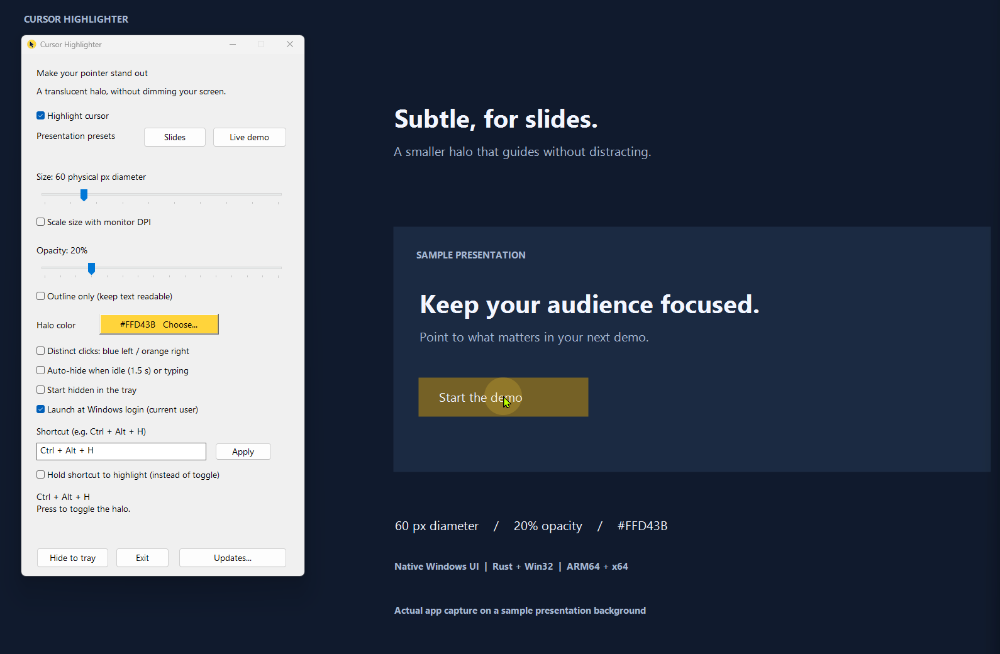
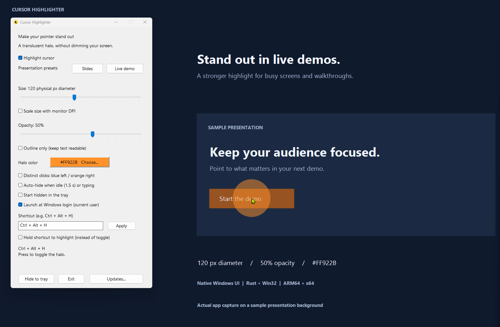
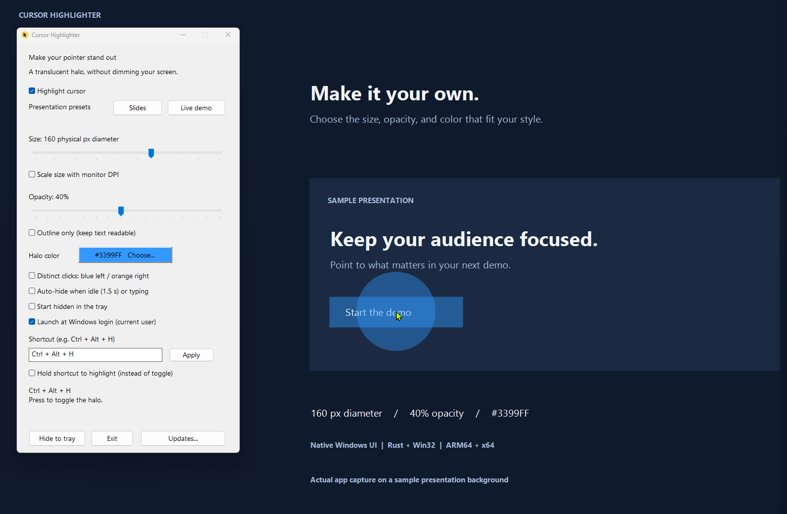
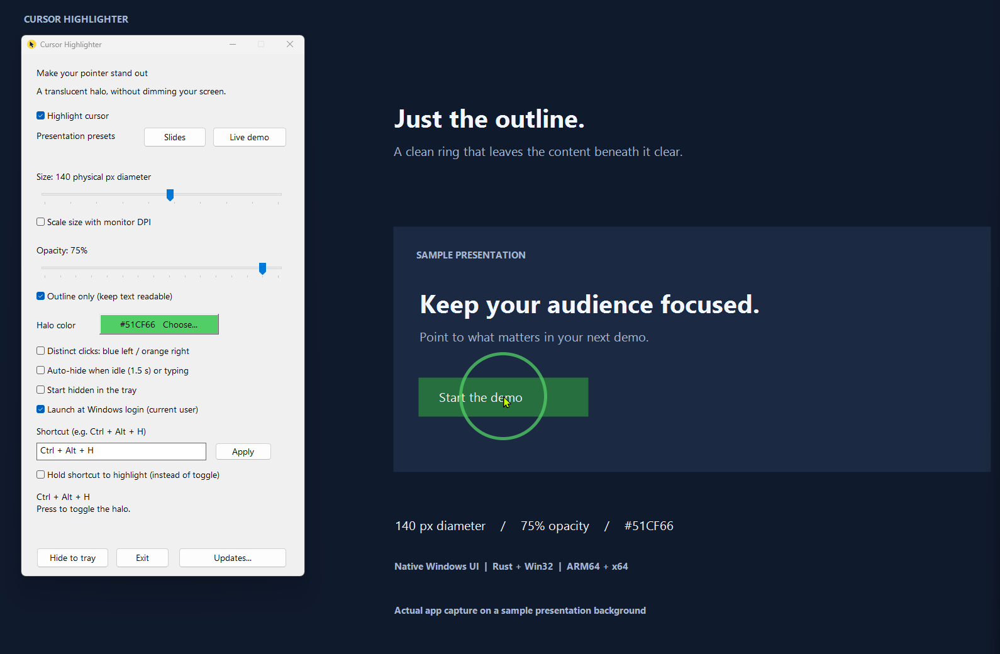

# Cursor Highlighter

A small **Rust application with a native Win32 UI** for Windows 10/11. It puts a
colored, translucent halo around the actual desktop cursor across normal desktop
applications. No screen dimming, click interception, browser/webview, .NET runtime,
administrator privileges or background service. Launch at Windows login is
available as an explicit opt-in; nothing is registered by default.

## Screenshots

The native settings window and live desktop halo, shown over a sample presentation.
Click any screenshot to view it at full size.

| Slides: subtle yellow halo | Live demo: stronger orange halo |
| --- | --- |
| [](docs/screenshots/slides-yellow.png) | [](docs/screenshots/live-demo-orange.png) |
| **Custom:** blue, 160 px, 40% opacity | **Outline only:** green ring, 140 px, 75% opacity |
| [](docs/screenshots/custom-blue.png) | [](docs/screenshots/outline-green.png) |

These examples use fixed physical-pixel sizing. The outline-only option keeps
the center transparent so text and controls remain clear beneath the cursor.
Screen-sharing visibility still depends on the sharing application and capture mode.

## Download

Published versions are available on the repository's **Releases** page. Download
`cursor-highlighter-windows-arm64.zip` for Windows on ARM or
`cursor-highlighter-windows-x64.zip` for Intel/AMD Windows, extract the archive,
and launch `cursor-highlighter.exe`. No Rust or .NET installation is needed.
Each archive has a matching `.sha256` file. The executables are not code-signed;
Windows SmartScreen may show an unknown-publisher warning.

### Automatic updates

Updater-enabled builds check this repository's public stable GitHub Releases
30 seconds after launch and every 24 hours while running. They compare SemVer
(so `0.10.0` is newer than `0.9.0`), ignore drafts/prereleases, and automatically
download the newest newer package for the **running executable's architecture**
(ARM64 or x64). Checks poll GitHub; this is not a real-time push subscription.
The bounded release query considers the 100 most recently published releases.
Already downloaded updates do not prevent checking for a still newer version.

Open **Updates...** in Settings or the tray menu for progress, errors, a manual
**Check for updates** action, and **Install and restart...**. A downloaded update
changes the Settings button to **Update ready...** and the tray tooltip; it never
opens a dialog, takes focus, stops the halo, or restarts the app on its own.
Installation requires clicking the install button and then answering **Yes**;
**No** is the default. Choose No to continue presenting. Pending downloads remain
available for the current app session; exiting normally discards them.

**Automatically check and download updates** is on by default and is persisted
as the additive `AutomaticUpdates` JSON boolean. Older settings files default to
on. Turning it off disables automatic network checks and downloads; manual checks
still work and existing downloaded updates can still be installed. An in-flight
automatic HTTP request may finish (within its timeout), but cancellation is
checked between requests and before staging, and its result is discarded.
Automatic errors appear in Updates instead of repeated modal dialogs.
Checks are serialized, manual checks are limited to once per minute, and failed
automatic checks back off from 15 minutes to at most 24 hours within the session.
Network work runs off the native UI thread, with a 10-second connection timeout,
120-second per-request timeout, and bounded responses (2 MiB metadata, 1 KiB
checksum, 32 MiB ZIP). HTTPS redirects are limited to five and restricted to
GitHub's release download hosts. No GitHub token is required or sent.

Before staging, the updater requires the release's matching `.zip.sha256` file,
checks the ZIP's size and SHA-256, accepts only the root executable and optional
`README.md`, and checks the executable's PE architecture. Expanded executables
are limited to 64 MiB. Paths, directories, symlinks, extra files, and duplicate
entries in the ZIP are rejected; archive paths are never used as output paths.
Checksums detect corruption, **not publisher authenticity or code signing**.
The releases and their checksums rely on the same GitHub account and HTTPS trust.

Installation preserves the portable executable's exact location/name,
`%LOCALAPPDATA%\CursorHighlighter\settings.json`, and the existing login registry
entry. The executable's directory must be writable: there is no administrator
prompt or service. Staging uses a unique `.cursor-highlighter-update-*` sibling
directory. After your confirmation, a copy of the current executable runs as a
scoped helper, opens a handle to this app, revalidates the staged ZIP/executable,
then waits for the app to exit. It revalidates again before replacement, keeps
`backup.exe` in that directory, and restores the original if replacement or
initialization of the restarted app fails. Only the newly spawned
replacement process may be stopped during recovery; other running copies are
never terminated. The restarted app acknowledges native initialization before
cleanup removes the backup and helper. Settings controls are briefly disabled
while the confirmed helper handoff is pending, preventing unsaved changes.

Permission/lock failures are reported without elevation. A failed helper or
power loss can leave its staging directory behind; do not delete it while an
update is running. If recovery reports a failed rollback, exit the app and
restore the reported `backup.exe` to the original executable path before retrying.
Automatic rollback covers reported replacement/startup failures, not power-loss
atomicity or failures occurring after successful initialization. Successful
cleanup deletes only the known updater files and the now-empty staging directory.

Published v0.2.0 and older builds do not contain this updater. Install an
updater-enabled release manually once to receive subsequent automatic downloads.

### What's new in v0.3.0

Automatic stable-release checks and verified architecture-matched downloads are
now built in. Open **Updates...** to check manually, disable automatic downloads,
or explicitly approve installation and restart. Updates never interrupt a
presentation without your confirmation. Settings and the portable executable
location are preserved, with backup/recovery during replacement.

### What's new in v0.2.0

This release includes all seven feature additions: optional idle/typing
auto-hide, distinct left/right click colors, configurable shortcuts with
hold-to-highlight mode, an outline-only halo, Slides and Live demo presets,
monitor-DPI-aware sizing, and start-hidden/per-user login startup options.
Existing settings remain compatible. All optional modes and startup options
remain off by default; the original filled halo and Ctrl + Alt + H toggle
remain the defaults. Launch at Windows login changes only when explicitly
selected in Settings.

## Run

Double-click `Run.cmd` in `C:\Projects\cursor-highlighter` to build and launch.
To launch the already-built version without any development tools:

```powershell
& 'C:\Projects\cursor-highlighter\target\release\cursor-highlighter.exe'
```

The release executable includes the icon, DPI manifest, and statically linked
Rust/C runtime. Copy just this executable to another Windows machine of the same
architecture. This machine builds **ARM64**; build for x64 on an x64 development
machine or use the MSVC cross-compilation instructions below.

## Controls

- **Highlight cursor** enables or disables the halo.
- **Presentation presets:** select **Slides** for a subtle 60-unit yellow
  (`#FFD43B`) halo at 20% opacity, or **Live demo** for a stronger 120-unit orange
  (`#FF922B`) halo at 50% opacity. Both are also available from the tray menu
  without opening Settings. Presets replace size, opacity, and color immediately,
  but preserve enabled, outline, distinct click colors, auto-hide, DPI sizing,
  startup, shortcut, and activation mode choices. Size uses the selected
  physical or logical units. You can still customize all three controls
  afterward; the resulting values are saved normally, with no preset field.
- **Size** adjusts the diameter from 24 to 240 physical screen pixels by default.
- **Scale size with monitor DPI** switches Size to logical pixels at 96 DPI.
  The halo follows the Windows scaling of the monitor under the cursor: an
  80-unit diameter renders as 80 pixels at 100%, 120 at 150%, and 160 at 200%.
  This keeps its perceived size consistent with other Windows UI across laptop
  and external displays. Uncheck it to restore fixed physical-pixel sizing.
  The Size label identifies the current units; the saved size value does not
  change when switching modes. Windows scaling, not measured panel dimensions,
  determines the result.
- **Opacity** adjusts transparency from 5% to 80%.
- **Outline only** draws an outline up to 5 physical pixels thick instead of
  filling the halo, keeping content under the cursor readable. It is off by
  default.
- **Choose...** previews the current halo color on the button, with contrasting
  text, and opens the standard Windows color picker.
- **Click feedback:** left, right, and middle presses slightly squash the halo and
  darken the selected color. It stays pressed during a drag and smoothly returns
  to normal after release. Even quick clicks remain visible briefly. Input is
  always forwarded to the underlying application.
- **Distinct clicks: blue left / orange right** optionally tints left clicks blue
  (`#3388FF`) and right clicks orange (`#FF6633`), retaining squash/darken feedback.
  Holding both shows blue on the left half and orange on the right half; each
  color fades independently after release. Middle clicks keep the usual feedback.
  This mode is off by default, preserving the existing appearance.
- **Shortcut:** defaults to **Ctrl + Alt + H**, which toggles the halo even while
  Settings is hidden. Enter a chord such as `Ctrl + Shift + F9` and click
  **Apply** to change it. Use Ctrl, Alt, or Win (optionally Shift) with a letter,
  digit, or F1-F24. Windows may reserve some combinations (including F12 and
  many Win shortcuts). Invalid or unavailable shortcuts show an error in Settings
  and leave the previous shortcut and saved settings unchanged. If the saved
  shortcut is unavailable at startup, choose another or use the checkbox/tray
  in toggle mode.
- **Hold shortcut to highlight (instead of toggle):** with **Highlight cursor**
  enabled, shows the halo only while the whole shortcut is held. Releasing any
  required key hides it on the next frame (about 16 ms). The checkbox and tray
  menu enable/disable highlighting; they do not latch the halo on in hold mode.
  Switching modes clears any temporary hold. Holding the shortcut never changes
  the saved enabled state. Toggle mode remains the default. An explicit hold
  takes priority over auto-hide, so idle/typing detection cannot hide the halo
  while you hold the shortcut.
- **Auto-hide when idle (1.5 s) or typing** is optional and off by default. When
  enabled, the halo fades out over 180 ms after 1.5 seconds without mouse
  movement, or as soon as keyboard activity is detected. Moving the mouse fades
  it back in over 180 ms. Typing keeps it hidden until the mouse moves, and the
  Highlight cursor toggle still takes priority. Keyboard detection observes only
  key-down activity: key identities and contents are not read or stored. The
  keyboard observer is installed only while this option is enabled.
- **Hide to tray** leaves the halo running. Double-click the notification icon or
  right-click it and select **Settings** to reopen the window.
- **Start hidden in the tray** skips showing Settings on subsequent launches;
  the halo and notification icon still run. Default: off.
- **Launch at Windows login (current user)** registers this executable for your
  Windows account, without administrator privileges. Default: off. Turn it off
  to remove the entry. This is independent of starting hidden: enable both for
  quiet startup at login.
- **Exit**, the tray's **Exit**, or closing Settings stops the app. Minimizing
  only minimizes Settings.

Defaults: 80 physical px diameter (DPI scaling off), yellow (`#FFD43B`),
35% opacity, filled halo, auto-hide off.
Settings changes apply immediately and save after a 400 ms debounce, on hide,
and on exit to `%LOCALAPPDATA%\CursorHighlighter\settings.json`.
**Existing settings from the previous C# version are preserved**: the file path
and existing PascalCase JSON fields have not changed. The additive `Shortcut`
and `ActivationMode` fields default to Ctrl+Alt+H and `Toggle` when absent.
The new `AutoHide` boolean
defaults to `false` when absent from older files. Corrupt/unreadable files show a
warning and use defaults. Save failures show a warning while changes remain
active in memory. Settings are written to a temporary file then atomically
replaced.
The optional click-color mode is stored as the `DistinctClickColors` boolean;
older settings files without it keep the default click feedback.
The optional `ScaleWithDpi` JSON boolean persists the DPI sizing choice. Older
settings files without this field retain physical-pixel sizing.

Launch-at-login registration uses only the `CursorHighlighter` value in
`HKEY_CURRENT_USER\Software\Microsoft\Windows\CurrentVersion\Run`, with the full
executable path quoted. Its checkbox reflects whether that entry exists rather
than a potentially stale JSON preference. Registration changes only when you
click the checkbox, never when loading or saving settings. Errors are shown and
the checkbox is restored on failure; if the entry cannot be read, the control is
disabled until restart. Windows may delay startup or disable it through Task
Manager's Startup apps settings. Exit does not unregister it. Keep the executable
in a stable location; turn the option off before moving/deleting it, then enable
it again from the new location. Paths exceeding Windows' 260-character Run
command limit cannot be registered.

Only one app instance is allowed per Windows session. Exit any older C# build
before starting the Rust build; they intentionally share the same instance guard.

## Build

Install these once:

1. Rust stable using [rustup](https://rustup.rs/), with the native **MSVC** host
   toolchain (`aarch64-pc-windows-msvc` on ARM64, `x86_64-pc-windows-msvc` on x64).
2. Visual Studio 2022 Build Tools with **Desktop development with C++**, the
   Windows 11 SDK, and the C++ compiler/libraries for your target architecture.
   ARM64 builds also need **MSVC ARM64/ARM64EC build tools**.

Then:

```powershell
Set-Location 'C:\Projects\cursor-highlighter'
.\Build.cmd
```

`Build.cmd` adds `%USERPROFILE%\.cargo\bin` to its own PATH, so it also works after
the toolchain installation in this session without restarting the shell.
In a shell where Cargo is already on PATH, the equivalent is:

```powershell
cargo build --release --locked
```

The Windows SDK resource compiler embeds `assets\CursorHighlighter.ico` and
`app.manifest` via `build.rs`. The custom icon is used for the executable,
settings window, taskbar, and notification area. To regenerate its seven
resolutions (16-256 px):

```powershell
powershell -ExecutionPolicy Bypass -File assets\Generate-Icon.ps1
```

To cross-compile for x64, install the x64 MSVC libraries/tools and SDK support:

```powershell
rustup target add x86_64-pc-windows-msvc
cargo build --release --locked --target x86_64-pc-windows-msvc
```

The resulting executable is `target\x86_64-pc-windows-msvc\release\cursor-highlighter.exe`.
Cross-compilation requires both the host toolchain's native libraries (for build
scripts) and the target libraries. There is no installer/publishing step.
Cargo downloads dependencies on the first build. The app contacts GitHub only
for enabled automatic updates or an explicit manual update check.

## GitHub Actions releases

The **Windows release** workflow builds and unit-tests on native Windows x64 and
ARM64 runners. It also checks formatting, runs Clippy, verifies the executable's
PE architecture, and uploads a ZIP plus SHA-256 checksum for each architecture.
It runs for pushes to `main`, pull requests, version tags, and manually through
**Actions > Windows release > Run workflow**. Workflow artifacts are retained for
30 days. Interactive desktop self-tests are deliberately not run on hosted CI;
run them locally as described below.

To publish a GitHub Release, update `version` in `Cargo.toml`, regenerate
`Cargo.lock` with `cargo check`, commit and push those changes, then push a
matching version tag:

```powershell
git tag v0.2.0
git push origin v0.2.0
```

Replace `v0.2.0` with the package version being released. A tag must exactly match
`v` followed by the Cargo package version. After both builds pass, the workflow
creates a GitHub Release with generated notes and attaches both architecture
packages and their checksums. Untagged/manual runs build artifacts without
publishing a release.

## Validation

```powershell
cargo fmt --all -- --check
cargo clippy --all-targets --locked -- -D warnings
cargo test --locked
cargo run --locked -- --self-test
```

Unit tests cover C# settings compatibility, shortcut parsing and validation,
activation-mode visibility and chord release, atomic persistence,
presentation preset values, persistence and subsequent manual customization,
click/release/overlapping-button timing, idle/typing fade timing and movement
restoration, auto-hide persistence and backward-compatible defaults, filled and
outline alpha, color darkening, deformation, independent left/right color timing,
optional/simultaneous click colors, and premultiplied rendering across sizes and
opacity values.
DPI tests cover
opt-in defaults, persistence in both modes, fractional-scale rounding, simulated
monitor transitions, larger scaled bitmaps, and negative-coordinate centering.
A hidden-window test checks DPI lookup and monitor selection on attached displays
without moving the real cursor, showing an overlay, taking focus, installing
hooks, or changing user settings. Simulated transitions and hidden-window checks
do not establish physical mixed-DPI cursor behavior.
Startup tests cover default-off JSON compatibility and quoted executable commands
(including spaces, Unicode, UNC paths, and invalid/overlong input). Tests never
register the app for login or change real user settings.
Hidden native windows and unused extended-function-key chords also check
shortcut conflicts, replacement, settings controls, and hold dispatch,
without injecting keyboard input or touching the running app or user settings.
Updater tests use mocked release/download fixtures and a loopback HTTP server
for version/architecture selection, opt-out compatibility, URL restrictions,
HTTP errors/timeouts/limits, checksum/ZIP rejection, cancellation, cooldown,
and bounded retry scheduling. Isolated filesystem tests cover staged tampering,
rename/permission errors, restart-failure rollback, and scoped cleanup. A real
multi-process fixture copies the test executable into a temporary portable-app
directory and exercises helper readiness, waiting for the parent to exit,
revalidation, replacement, initialization acknowledgment, and cleanup. Its ignored
`process_driver` test is invoked automatically only by that fixture. Hidden native
Updates-window tests cover opt-out persistence, disabled install controls, DPI
layout, and lack of focus changes, without networking or showing a dialog.
These checks do not install a public release or replace your running executable.

`--self-test` additionally creates real native windows and exercises the
notification icon, hook installation, custom window icons, click-through and
no-activation behavior, cursor centering, topmost placement, native controls,
hotkey dispatch, optional keyboard observer lifecycle, idle/typing hiding and
mouse-movement restoration, settings persistence, DPI-scaled control layout,
live DPI sizing checkbox changes, and actual desktop compositing for both halo
styles in normal and pressed states. It uses an isolated
temporary settings file, never overwriting your settings. Close the running app
first, keep the desktop unlocked, and leave the cursor still over a static area
while running this check. It calls the mouse-observer callback directly to check
click feedback and calls the keyboard observer with activity-only messages; it
does not inject real clicks or keystrokes into your desktop.

Before a presentation, also verify interactively:

1. Move the pointer across all monitors, including mixed-DPI displays. Check both
   sizing modes, monitor boundaries, and displays left of or above the primary
   display; repeat while holding a mouse button and after changing display scale.
2. Click, drag, scroll, and type in the applications you plan to present.
3. Check the audience's view or a test recording in your sharing application.

## Implementation and limitations

`windows-sys` provides direct Win32 bindings; there is no GUI framework.
`src\desktop.rs` owns the native windows, controls, tray, timers, hook, color
dialog, shortcut, and GDI resources on one UI thread. `src\model.rs` contains
settings, click/auto-hide timing, and anti-aliased premultiplied BGRA rendering. The
optional outline is formed by subtracting an inset ellipse from the filled
shape, preserving the existing alpha, color, and click-feedback behavior.
`src\startup.rs` owns the current-user launch-at-login registry entry.
`src\updater.rs` owns release selection, bounded HTTPS downloads using Windows
certificate validation, verified ZIP staging, background update scheduling, and
the scoped installer helper/rollback protocol. Update status is polled by a
separate native timer; halo rendering and hooks stay on the original UI thread.

The halo is a per-pixel-alpha, click-through, non-activating layered topmost
window. A 16 ms timer follows desktop cursor coordinates; only appearance changes
regenerate its bitmap. The low-level mouse hook observes button transitions and
movement; the optional low-level keyboard hook observes activity without reading
key data. Both always forward input without rendering inside the callback.
Auto-hide fades use the layered window's constant alpha, preserving the selected
color, opacity, and click feedback. Per-monitor V2 DPI
awareness scales Settings on monitor changes. Halo dimensions remain fixed in
physical pixels by default. When DPI sizing is enabled, a hidden, non-activating
1-pixel window selects the cursor's monitor and `GetDpiForWindow` reads its current
effective DPI. This avoids selecting a monitor based on the larger halo's area
when it straddles a boundary. The frame timer regenerates the bitmap when the
scaled diameter changes, including while click feedback is active. DPI lookup
and positioning use the same cursor sample. Negative desktop coordinates are
supported; the halo clips naturally at display edges.

Shortcuts use Windows global hotkey registration with repeat suppression.
Replacement shortcuts are registered before the old registration is released,
so a conflict does not disable a working shortcut. Hold mode uses the existing
frame timer to inspect only the configured chord's current key states after a
hotkey activation. Hold mode adds no keyboard hook and records no keystroke
history; the separate auto-hide option still controls its activity-only observer.

**Screen sharing capture is application- and mode-dependent.** Sharing an entire
display often captures desktop overlays; sharing a single application may omit
the halo. There is no guarantee of capture in every sharing/recording mode.
Exclusive full-screen applications, other topmost overlays, and protected content
may obscure it. The app does not draw on the Windows secure desktop
(UAC/sign-in/lock screens) and is not designed for remote/headless sessions.
Actual mixed-monitor interactions and audience capture are not established by
the automated checks.
